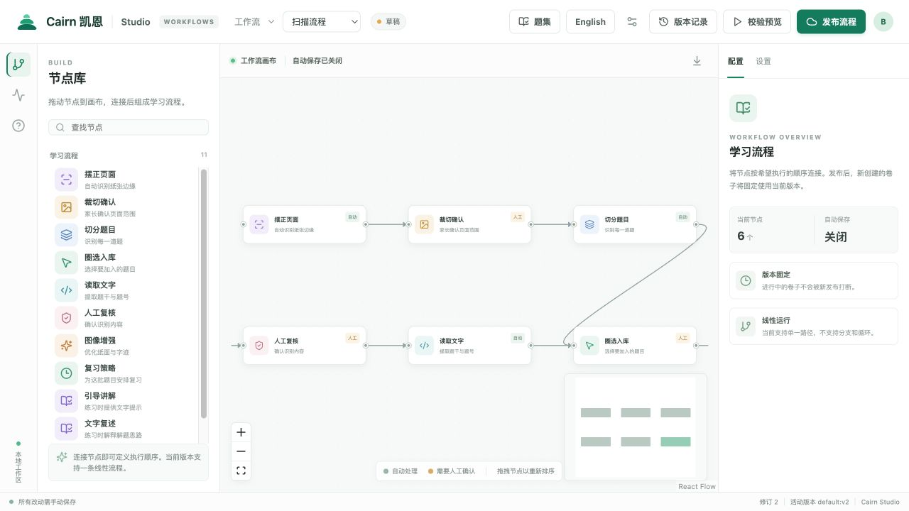

# Cairn

**A configurable learning platform built around a visual workflow canvas.**

[简体中文](README.md) · [Architecture and extensibility](docs/PLATFORM.md) · [License](LICENSE)

Cairn turns learning methods into composable steps. Educators, parents, and organizations configure and publish workflows in an authoring canvas; learners use a consistent, focused application. Reviewing mistakes is the first working scenario, with a broader goal of supporting different subjects, content, and teaching methods.

## Author workflows visually



**Cairn Studio** is a separate authoring application for arranging nodes, setting parameters, saving drafts, validating, and publishing versions. Built-in nodes currently cover page alignment, crop confirmation, question segmentation, selection, text recognition, human review, review strategies, guided explanations, text recall, and collections.

For example, a mathematics workflow can combine paper capture, recognition, human review, and spaced practice. A language-learning workflow can be organized around collections, explanations, and recall. The right combination depends on the subject and teaching context.

**A canvas and a plugin ecosystem are Cairn's long-term direction**: subject specialists should be able to bring their own content sources, processing tools, learning methods, and outputs. The current release has a built-in node catalog and tool registry with validated linear workflows. A third-party plugin marketplace, dynamic plugin loading, branches, and loops are future work, not features available today.

## A focused learner experience


Learners and parents use a fixed Cairn interface to capture papers, confirm questions, practice, and follow progress. Published workflows determine supported steps and parameters; the authoring graph stays in the backend.

Both screenshots were made with isolated synthetic data; they do not contain real student or family information.

## Quick start

Requirements: Python 3.12, Node.js, and npm. Start the reader and authoring applications locally:

```bash
python3.12 -m venv .venv
.venv/bin/pip install -e ".[dev]"
.venv/bin/uvicorn cairn.web:app --host 127.0.0.1 --port 8000
```

In a second terminal:

```bash
cd workflow-canvas
npm ci
CAIRN_API_TARGET=http://127.0.0.1:8000 npm run dev -- --host 127.0.0.1
```

Reader: `http://127.0.0.1:8000/`; Studio: `http://127.0.0.1:5173/`. Authoring writes require an operator credential configured on the server and connected in Studio; see the [Studio guide](workflow-canvas/README.md) for deployment and API details. Do not expose an unauthenticated service to the public internet.

## Current status

- The workflow canvas, version publishing, and scan execution are in internal testing. Execution currently supports a single linear path.
- Model-assisted explanations and recall require a configured model service. Experimental vision-model checks do not mean every scanning step uses a vision model.
- The Android client is not included in this public snapshot.
- Additional subject capabilities, third-party plugin mechanisms, and community sharing are directions for future development.

## Public snapshot

This repository is an independent snapshot without the original Git history, real paper photographs, private deployment records, or textbook word lists. Supply data you have permission to use; see the [word-bank format](docs/WORDBANK-FORMAT.md). Some tests require private image or word-list fixtures and cannot be run in full from this snapshot alone. For offline container builds, first generate the wheelhouse with `deploy/make-wheels.sh`; explicitly set your own `CAIRN_IMAGE` before pushing an image.

## Built with and acknowledgements

Cairn builds on open-source projects including [FastAPI](https://fastapi.tiangolo.com/), [SQLAlchemy](https://www.sqlalchemy.org/), [React](https://react.dev/), [React Flow](https://reactflow.dev/), [Vite](https://vite.dev/), [FSRS](https://github.com/open-spaced-repetition/fsrs4anki), and [RapidOCR](https://github.com/RapidAI/RapidOCR). We thank their maintainers and contributors for the foundations of the web application, canvas, review scheduling, and text recognition.

See [NOTICE](NOTICE) for third-party references and retained notices for the historical voice prototype. Audio entry is not a current development priority.

## License

Cairn's own code is available under the [Apache License 2.0](LICENSE). Third-party dependencies and assets retain their own licenses and attribution requirements; see [NOTICE](NOTICE).
