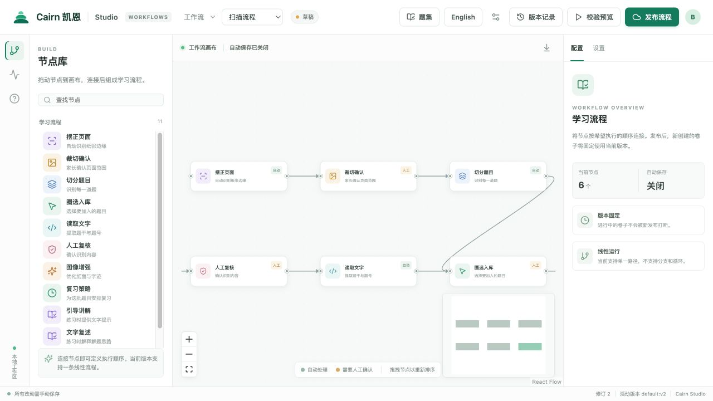
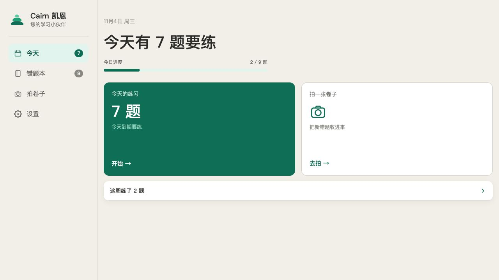

# Cairn 凯恩

**一个以工作流画布为核心的可定制学习平台。**

[English](README.en.md) · [架构与扩展](docs/PLATFORM.md) · [许可证](LICENSE)

Cairn 将学习方法拆成可以组合的步骤。教师、家长和机构在后台选择节点、配置参数并发布流程；学习者在统一的前台完成练习。错题复习是第一个落地场景，平台希望逐步支持不同学科、内容和教学方法。

## 后台：用画布搭建学习流程



**Cairn Studio** 是独立的作者端：通过节点和连线编排步骤，保存草稿、检查配置并发布版本。当前节点涵盖页面摆正、裁切确认、切分题目、圈选、文字读取、人工复核、复习策略、引导讲解、文字复述和题集等。

例如，数学可以组合卷面采集、识别、人工复核与间隔复习；语言学习可以围绕题集、讲解和复述设计流程。不同学科需要什么步骤，由其教学场景决定。

**画布 + 插件生态是 Cairn 的长期方向**：让专业领域逐步接入自己的内容来源、处理工具、学习方法和输出方式。当前版本已有内置节点目录与工具注册机制，支持受校验的线性流程；第三方插件市场、动态插件加载、分支与循环仍属于未来工作，并非当前已交付功能。

## 前台：专注学习



学习者和家长使用固定的 Cairn 界面：拍卷子、确认题目、查看错题、练习和跟踪进度。已发布工作流决定支持的步骤与参数；节点图留在后台，避免把搭建复杂度带给孩子。

两张截图均使用独立的合成数据，不包含真实学生或家庭资料。

## 快速开始

需要 Python 3.12、Node.js 和 npm。下面的命令在本机启动独立的读者端与作者端：

```bash
python3.12 -m venv .venv
.venv/bin/pip install -e ".[dev]"
.venv/bin/uvicorn cairn.web:app --host 127.0.0.1 --port 8000
```

在另一个终端启动画布：

```bash
cd workflow-canvas
npm ci
CAIRN_API_TARGET=http://127.0.0.1:8000 npm run dev -- --host 127.0.0.1
```

读者端：`http://127.0.0.1:8000/`；Studio：`http://127.0.0.1:5173/`。作者端的写操作需要在服务端配置 operator 凭据并在 Studio 中连接；部署与 API 细节见 [Studio 说明](workflow-canvas/README.md)。不要将未经认证的服务直接暴露到公网。

## 当前阶段

- 工作流画布、发布版本与扫描执行链已进入内部测试；现阶段只支持单条线性流程。
- 模型讲解和复述依赖模型服务配置；视觉模型的实验验证不代表已经接入所有扫描环节。
- 安卓客户端尚未包含在本公开快照中。
- 更多学科能力、第三方插件机制、社区与共享生态是发展方向，需要逐步实现和验证。

## 公开快照的内容

本仓库从现有版本导出为独立快照，不包含原仓库历史、真实卷面照片、私人部署记录或教材词表。请自行准备有权使用的数据，词表格式见 [导入说明](docs/WORDBANK-FORMAT.md)。部分测试依赖未公开的真实图像或词表，无法仅凭本快照完整运行。容器离线构建需要先运行 `deploy/make-wheels.sh` 生成 wheelhouse；推送镜像时须显式设置自己的 `CAIRN_IMAGE`。

## 技术与致谢

Cairn 使用 [FastAPI](https://fastapi.tiangolo.com/)、[SQLAlchemy](https://www.sqlalchemy.org/)、[React](https://react.dev/)、[React Flow](https://reactflow.dev/)、[Vite](https://vite.dev/)、[FSRS](https://github.com/open-spaced-repetition/fsrs4anki) 和 [RapidOCR](https://github.com/RapidAI/RapidOCR) 等开源项目。感谢这些项目及其贡献者为 Web、画布、复习调度和文字识别提供的基础。

历史语音原型参考的第三方项目和保留的许可说明见 [NOTICE](NOTICE)。语音入口不是当前开发重点。

## 许可

Cairn 自有代码采用 [Apache License 2.0](LICENSE)。第三方依赖和素材保留其各自的许可及署名要求，详见 [NOTICE](NOTICE)。
